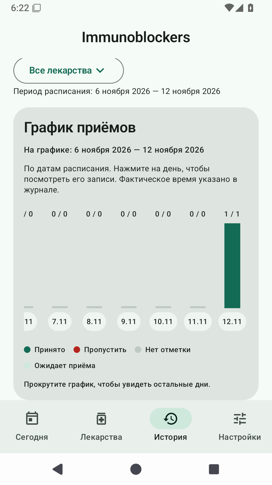
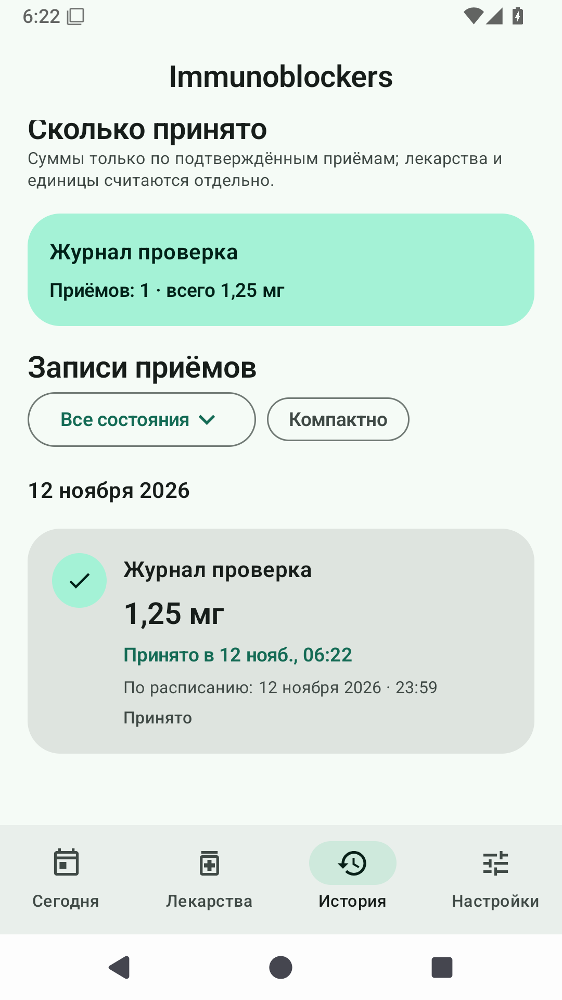
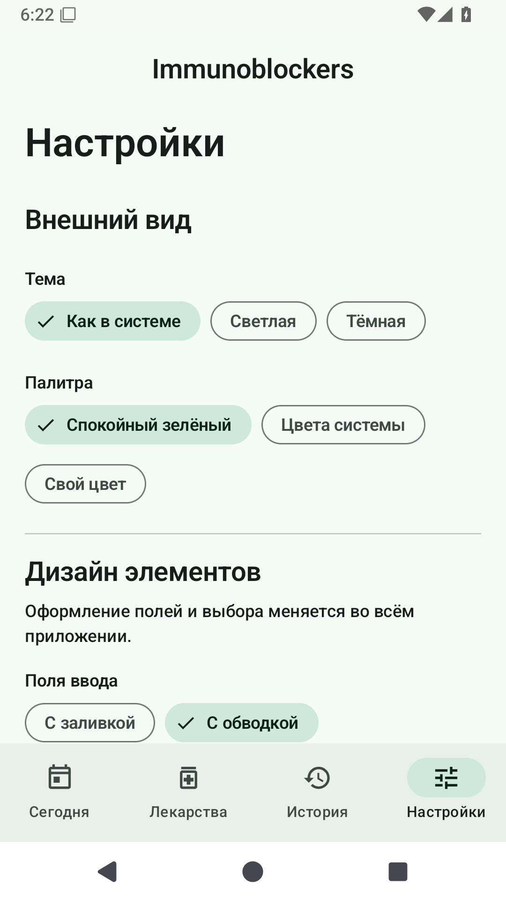
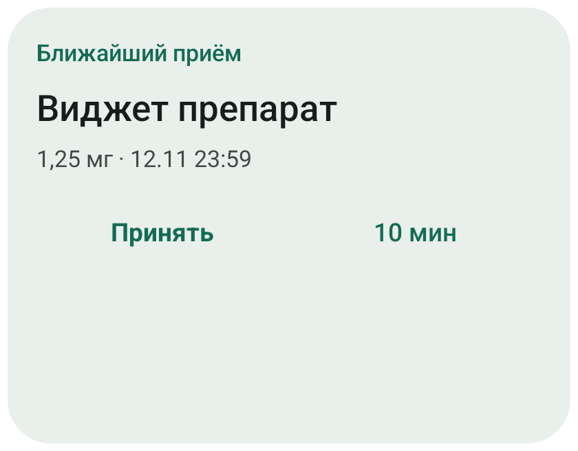
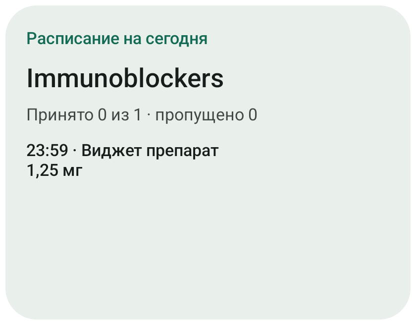
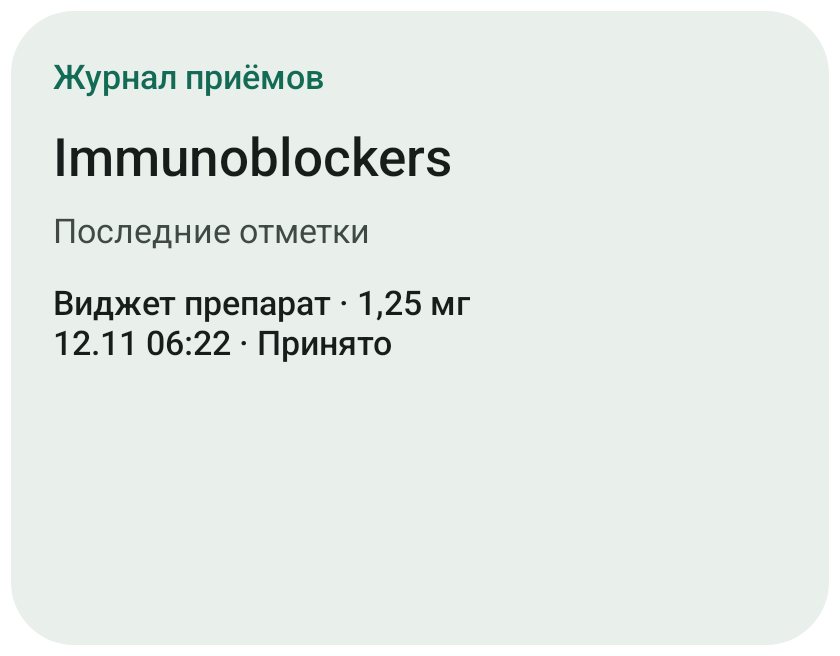

# Immunoblockers 0.2.0

## Виджеты рабочего стола

В настройках есть галерея из трёх вариантов:

- **Ближайший приём**: название, дозировка, дата и время; действия «Принять» и «10 мин». После последнего приёма сегодня показывает ближайший будущий приём. Перенос сохраняет исходную запись и показывает новое время.
- **Расписание на сегодня**: число принятых/запланированных/пропущенных и список ожидающих приёмов.
- **Журнал приёмов**: последние отметки с названием, дозировкой, временем и состоянием. Нажатие открывает историю приложения.

Нажмите «Добавить виджет» и подтвердите добавление в системном лаунчере. Если лаунчер не поддерживает такой запрос, добавьте виджет через долгое нажатие на рабочий стол → «Виджеты» → Immunoblockers. Можно изменить размер; количество строк зависит от доступной высоты. Длинные строки могут сокращаться, полная запись доступна в приложении.

Виджеты используют тему и цвет приложения. Есть переключатель скрытия названий и дозировок. Обновляются после действий приложения и напоминаний; Android также запрашивает периодическое обновление раз в30минут. Фоновое обновление зависит от ограничений системы и лаунчера.

## График и журнал

Откройте «История». Доступны 7 дней,30 дней и все записи, фильтр лекарства/состояния и выбор даты. График показывает максимум последние30 дней выбранного периода. Нажатие на столбец выбирает день; повторное нажатие снимает выбор.

Столбец относится к исходной дате расписания. В нём отдельно представлены принятое, пропущенное пользователем, отсутствие отметки за прошедший день и ожидающие приёмы. Перенос через полночь сохраняет исходную дату; фактическое время видно в записи.

В журнале видны название, разовая дозировка, фактическая отметка и время по плану. Есть компактный режим и исправление записи. Суммы строятся только по состоянию «Принято»: отдельно для каждого ID лекарства, исторического названия и единицы. Миллиграммы, миллилитры и таблетки не складываются между собой. Десятичные дозы суммируются точно через BigDecimal. При изменении названия или дозы старые снимки в истории сохраняются.

## Оформление

Настройки → «Дизайн элементов»: поля с заливкой/обводкой, три варианта скругления карточек и полей, переключатель чуть более жирного шрифта и интерактивный пример поля. Названия и заголовки используют SemiBold, основные значения — Medium. Календарь и часы используют Material 3; в часах можно переключиться на ввод с клавиатуры.

На «Сегодня» отдельно включаются прогресс, ближайшее лекарство, последние отметки и недельный график. Цвета, режим темы и анимации сохранены из предыдущей версии.

В единицы дозировки добавлены мг, мкг, г и собственный текст. Дозу вводит пользователь; приложение её не назначает и не пересчитывает силу таблетки.

## Обновление

Пакет остаётся `com.immunoblockers`, versionCode увеличен до 2. Room-схема v1 не менялась, новые настройки DataStore добавлены с совместимыми значениями по умолчанию. Публичный APK подписывается прежним сертификатом для установки поверх 0.1.0 с сохранением данных. Закрытый ключ в GitHub не передаётся.

## Примеры экранов

Скриншоты сняты на Android 15. Тестовые записи созданы автоматической проверкой; в приложении отображаются введённые пользователем лекарства.

  

  
