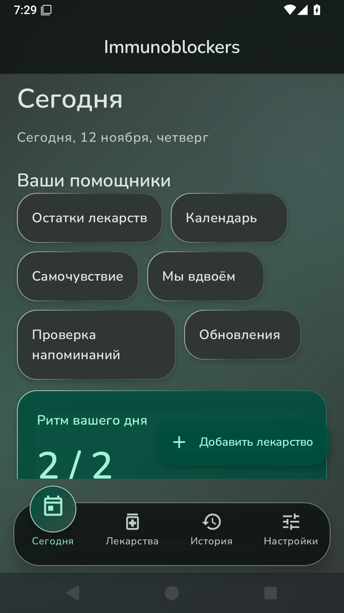
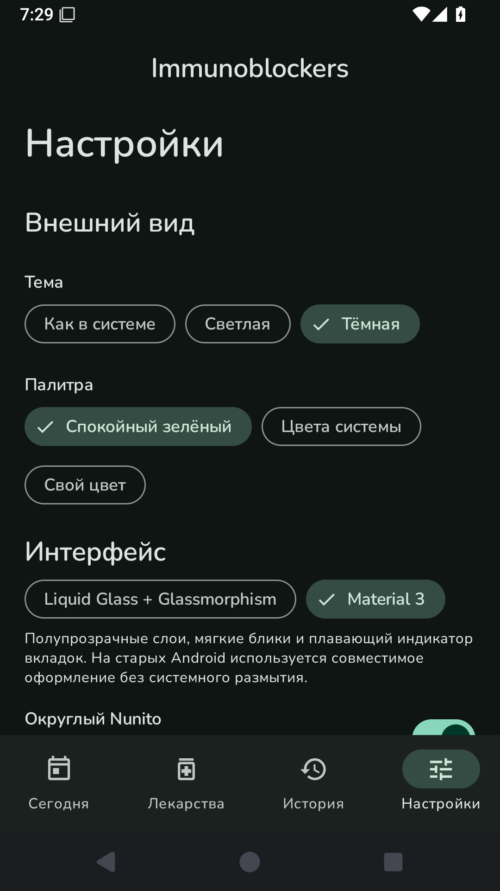
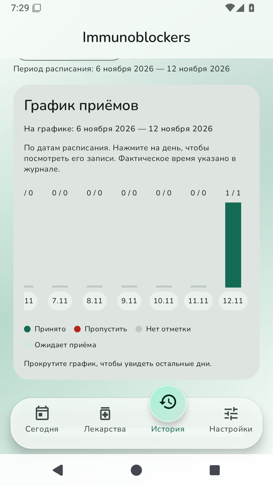
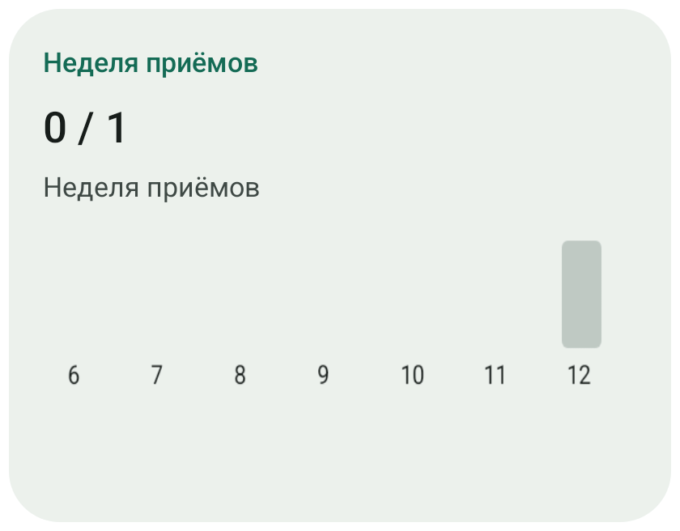
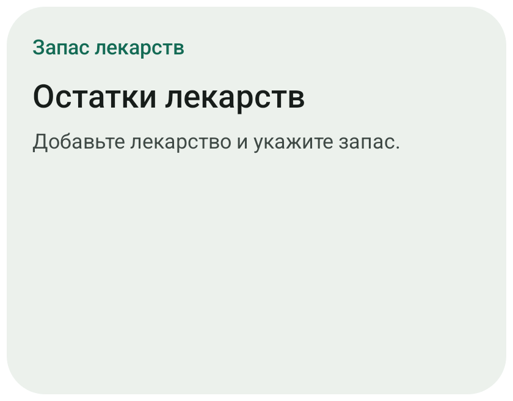

# Версия 0.3.0

В настройках выберите **Liquid Glass + Glassmorphism** или **Material 3**. Стеклянный вариант использует полупрозрачные поверхности, световые границы, мягкий фон и плавающий индикатор вкладок с пружинным перемещением. Это интерпретация анимации из присланного видео. Округлый шрифт Nunito можно заменить системным. Сохранены светлая/тёмная тема, свои цвета, формы полей и уменьшение движения.

На экране «Сегодня» появились карточки запасов, календаря, самочувствия, партнёра, проверки напоминаний и обновления. Панель можно скрыть в настройках.

## Пять виджетов рабочего стола

Ближайший приём, прогресс дня, список приёмов, график недели и запасы. Добавляйте через меню виджетов лаунчера. В настройках есть приватный режим, размер текста, оформление и подтверждение отметки. По умолчанию «Принято» открывает подтверждение в приложении; там доступна отмена. Виджеты недели и запасов открывают соответствующий раздел.

## Запасы и самочувствие

Укажите текущий остаток в единицах лекарства и порог предупреждения. Уже отмеченные приёмы не списываются повторно. Новые отметки уменьшают остаток; отмена восстанавливает его. Записи с другой единицей не пересчитываются автоматически. Это ручной учёт, сверяйте его с фактическим запасом.

Самочувствие: три состояния и заметка с датой. Состояние сообщает сам пользователь; приложение не ставит диагнозы и не выводит состояние здоровья из пропущенного приёма.

## Для пары

Нужен постоянно доступный HTTPS-сервер: [инструкция](../server/README.md). GitHub хранит исходники и APK, но не запускает сервер обмена. В этой версии публичный сервер не развёрнут.

1. Один партнёр вводит адрес сервера и создаёт пару.
2. Передаёт приватный код приглашения второму; второй вставляет код.
3. Каждый отдельно включает передачу лекарств/дозировок и/или самочувствия. По умолчанию оба разрешения выключены.
4. Нажмите «Обновить» на обоих устройствах. При наличии сети действует также фоновая синхронизация WorkManager с минимальным интервалом 15 минут; Android может её задерживать.

Партнёр видит разрешённые лекарства, расписание, последние 30 записей, самочувствие и время обновления. Есть сообщения «Обнимаю», «Я рядом», «Напиши мне». Партнёр не может менять ваши дозы и отметки. Данные шифруются AES-GCM на устройстве; серверу доступны адреса соединений, идентификаторы и времена запросов, но не содержимое.

Выключение разрешения заменяет опубликованный снимок при следующей успешной синхронизации. Разрыв пары останавливает отправку сразу и удаляет комнату на сервере при успешном запросе. При ошибке повторите разрыв с сетью. Уже просмотренную или скопированную партнёром информацию невозможно отозвать. Потеря приложения/его данных требует создания новой пары.

## OTA из репозитория

«Обновление» проверяет последний стабильный GitHub Release PANDORA615/Immunoblockers. Фоновая проверка — не чаще раза в сутки. Загрузка запускается вручную, установка — через системное окно Android. Проверяются SHA256 GitHub, размер, имя пакета, более высокий versionCode и совпадение сертификата с установленной версией. Отдельных APK для архитектур нет. При необходимости разрешите установку из этого приложения в настройках Android и повторно нажмите установку.

Для будущих обновлений издатель должен сохранить существующий ключ подписи и увеличивать versionCode и семантическую версию. Проверка текущего релиза на 0.3.0 вернёт, что обновления нет.

## Примеры с эмулятора

[Видео вкладок](screenshots/0.3.0/navigation.mp4).

 

 
